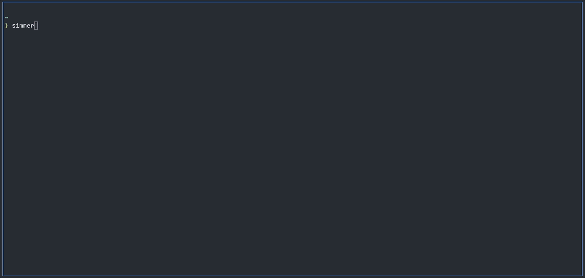

<div align="center">
   
</div>

> A lightweight, modern TUI for managing iOS Simulators and Android Emulators on macOS.

[](https://go.dev)
[](https://github.com/gusilva/simmer/actions/workflows/ci.yml)
[](https://codecov.io/gh/gusilva/simmer)
[](LICENSE)

---

<p align="center">
  
</p>

## 🚀 Features

- **Unified View:** See all your iOS and Android virtual devices in one list.
- **Real-time Status:** Instantly see if a device is `Running` or `Shutdown`.
- **Fast Discovery:** Parallelized scanning using `xcrun simctl` and `adb`.
- **Filtering:** Quickly find devices by name or OS version using built-in fuzzy search.
- **Headless Mode:** The same device data without the TUI — `simmer devices`, `simmer apps`,
  `simmer db ls`, `simmer db query`, each with `--json` for scripting.
- **File Browser:** Walk a device's filesystem or an app's own storage — on Android that spans both the private data dir and external app storage. Directories load as you expand them, so shared storage (`/storage/emulated/0/...`) is reachable to any depth, and pressing enter on a `.db` file opens it in the viewer.
- **Find Files:** `/` narrows the rows already on screen; `ctrl+f` takes the same query to the device and searches every root the tree covers, so a file in a directory you never opened is still found. Enter on a result opens a database or moves the tree to it.
- **Database Viewer:** Full-screen SQLite inspector — browse tables/views/indexes/triggers, write and run SQL queries, and view results in a scrollable table. Supports custom table-list queries and persists settings to `~/.config/simmer/config.toml`.
- **Modern UI:** Built with the latest Charm v2 terminal stack.

## 🛠 Tech Stack

- **Go 1.25+**
- **[Bubble Tea v2](https://charm.land/bubbletea/v2):** The TUI framework.
- **[Bubbles v2](https://charm.land/bubbles/v2):** Reusable UI components (List, Status Bar).
- **[Lip Gloss v2](https://charm.land/lipgloss/v2):** Beautiful terminal styling.

## 📦 Installation

### Download pre-built binary (recommended)

Go to the [Releases](../../releases/latest) page and download the binary for your Mac:

- `simmer` — universal binary (Intel + Apple Silicon)
- `simmer-darwin-arm64` — Apple Silicon only
- `simmer-darwin-amd64` — Intel only

Or via `curl`:

```bash
curl -L https://github.com/gusilva/simmer/releases/latest/download/simmer -o simmer
chmod +x simmer
./simmer
```

### Install with Go

```bash
go install github.com/gusilva/simmer@latest
```

## 📋 Prerequisites

- **macOS** (Required for iOS simulators).
- **Xcode** with Command Line Tools installed.
- **Android SDK** with `adb` and `emulator` in your `PATH`.
- **`sqlite3` on your Mac**, for the database features. Android images have shipped without it
  since Android 9, so Simmer copies a database off the device and queries it locally when the
  device cannot. Reads are current; writes reach only the copy.

## 📖 Usage Guide

### Running locally

```bash
make run
```

### Headless commands

Running `simmer` with no command opens the TUI. Naming a command runs it headlessly and prints to stdout,
so device data can be piped into other tools:

```bash
simmer devices                                    # every simulator, emulator and phone
simmer apps --device "iPhone 16 Pro"              # apps installed on one device
simmer db ls --device booted --app com.acme.app   # SQLite databases in an app's storage
simmer db ls --device booted --path /storage/emulated/0/Download  # …or under any directory
simmer db query --device booted --app com.acme.app \
  --db /data/data/com.acme.app/databases/rooms.db "select count(*) from rooms"
```

A `--device` reference is a UDID or adb serial, a device name, an unambiguous fragment of a name, or
`booted`. Omit it and the only running device is used; a reference matching several devices is reported
with the candidates rather than resolved arbitrarily.

Every command takes `--json` for machine-readable output. `apps` additionally takes `--fast` (skip all
per-app lookups) and `--react-native=false` (keep version names, skip React Native detection). Exit
status is `1` for a failed operation and `2` for a command-line error.

### Keybindings

`?` opens a help overlay listing the keys for whatever has focus. The essentials:

| Key         | Sidebar        | Apps panel       | Files panel                      |
| ----------- | -------------- | ---------------- | -------------------------------- |
| `↑/↓` `k/j` | move           | move             | move                             |
| `enter`     | collapse group | launch app       | expand directory / open database |
| `/`         | filter devices | filter apps      | filter loaded rows               |
| `ctrl+f`    | —              | —                | search the whole device          |
| `space`     | load device    | browse app files | —                                |
| `2` / `3`   | —              | focus Apps       | focus Files                      |

Device actions live on the sidebar: `b` boot, `s` shutdown, `a` add, `d` delete, `r` refresh, `i`
device info. App actions live on the Apps panel: `a` install, `d` uninstall, `c` close, `l` log to
file, `r` rebuild and reinstall, `m` more. `ctrl+d` opens the SQLite viewer from anywhere, and
`q` or `ctrl+c` quits.

### Building for production

```bash
go build -tags release -o simmer ./cmd/simmer
```

The `release` build tag strips all profiling code — `--pprof` and `--heap-out` flags are not registered,
and no `net/http/pprof` or `runtime/pprof` symbols are linked into the binary.
Dev builds (no tag) include profiling support by default.

### Versioning

Release binaries embed the git tag as the app version (for example, `v1.2.3`), injected at build time by the release workflow.
Local builds default to `dev` unless you set the linker variable manually.

### Running checks

`make check` runs what CI runs — build, vet, tests, formatting, and two gates worth knowing about:

- **Build exclusions.** A file named `search_android.go` or `sqlite_ios_test.go` is excluded from
  the build by its own name, on every machine, with no error from `go build`, `go vet` or
  `go test`. `scripts/check-build-exclusions.sh` fails on one.
- **Dead code.** Code unreachable from both the binary and the tests fails the build rather than
  accumulating.

```bash
make check         # everything CI enforces, lint included
make check-device  # integration tests against attached devices (skipped without hardware)
```

Lint is scoped to code that differs from `origin/main`, exactly as the CI job is, so the tree's
pre-existing findings do not fail every change. `make lint` reports the whole tree.

## 📝 Logging

Simmer can log every command it runs against the iOS and Android toolchains — which is how to find
out what a device actually answered when a listing comes back empty or a query fails.

Logging is **off by default**. Pass `--log` to enable it:

```bash
simmer --log            # TUI
simmer --log devices    # or any headless command
```

Logs are appended to `simmer.log` in the working directory, one line per command:

```
2026-10-29T21:07:12+01:00 INFO exec emulator [-list-avds] err=<nil>
2026-10-29T21:07:13+01:00 INFO exec xcrun [simctl list devices available --json] err=<nil>
2026-10-29T21:07:14+01:00 ERROR read external storage for com.acme.app err=ls: … Permission denied
```

### Log levels

Control verbosity with `--log-level` (default: `INFO`):

| Level   | What is recorded                                            |
| ------- | ----------------------------------------------------------- |
| `ERROR` | Commands that returned an error                             |
| `WARN`  | Commands that produced output (potential warnings) + errors |
| `INFO`  | Every command executed (default)                            |
| `TRACE` | Every command with its full combined output                 |

```bash
# Capture everything — command + full output
simmer --log --log-level TRACE

# Only see what failed
simmer --log --log-level ERROR
```

Global flags go before the command: `simmer --log devices`, not `simmer devices --log`.

## 🔬 Profiling & Heap Analysis

> **Dev only.** Profiling is compiled out of release binaries (`-tags release`). Run a dev build to use these flags.

Simmer ships two flags for memory profiling. Because it is a full-screen TUI that owns the terminal,
the standard approach of curling a pprof HTTP endpoint from the same shell is awkward.
The flags below give you two complementary workflows.

### Live HTTP endpoint (`--pprof`)

Starts a `net/http/pprof` server in the background. The TUI runs normally; you query the endpoint from a second terminal.

```bash
go run ./cmd/simmer --pprof localhost:6060
```

**Useful queries from a second terminal:**

```bash
# Interactive browser (flamegraph, top, source)
go tool pprof -http=:8080 http://localhost:6060/debug/pprof/heap

# Dump to file (add ?gc=1 to force GC before sampling)
curl -s "http://localhost:6060/debug/pprof/heap?gc=1" > heap.out
go tool pprof heap.out
```

### Signal-triggered file dumps (`--heap-out`)

Writes a timestamped heap profile every time you send `SIGUSR1` to the process, and one final
profile on clean exit. No second terminal needed for the curl — just `kill -USR1`.

```bash
go run ./cmd/simmer --heap-out /tmp/simmer-heap
```

Each signal creates a file named `<prefix>_HHMMSS.out`:

```
/tmp/simmer-heap_143022.out   ← baseline
/tmp/simmer-heap_143158.out   ← after doing something
/tmp/simmer-heap_143310.out   ← final (also written on exit)
```

**Taking a snapshot:**

```bash
kill -USR1 $(pgrep simmer)
```

### Recommended investigation workflow

Use `--heap-out` to capture snapshots at known points, then diff them with `go tool pprof -base` to isolate what grew.

```bash
# 1. Start
go run ./cmd/simmer --heap-out /tmp/h

# 2. Baseline — app just launched
kill -USR1 $(pgrep simmer)          # /tmp/h_HH0000.out

# 3. Peak — do the thing (load sims, stream logs, etc.)
kill -USR1 $(pgrep simmer)          # /tmp/h_HH0100.out

# 4. Recovery — undo the thing (stop sims, switch device)
kill -USR1 $(pgrep simmer)          # /tmp/h_HH0200.out

# 5. Diff peak vs recovery — anything still live is a candidate leak
go tool pprof -base /tmp/h_HH0100.out /tmp/h_HH0200.out
(pprof) top10
(pprof) list <FuncName>
```

Both flags can be combined:

```bash
go run ./cmd/simmer --pprof localhost:6060 --heap-out /tmp/simmer-heap
```

For CPU profiles (`--cpu-out`), execution traces (`--trace-out`), benchmarks and recording
before/after results, see [docs/architecture/performance.md](docs/architecture/performance.md).

### Reading the output

| pprof type                     | What it measures                        |
| ------------------------------ | --------------------------------------- |
| `inuse_space` (default)        | Bytes currently live on the heap        |
| `alloc_space` (`-alloc_space`) | Total bytes ever allocated (ignores GC) |

`inuse_space` is the right view for leak hunting — if a symbol shows up here after you expect it to be freed,
it is retained. Use `-alloc_space` to find hot allocation paths regardless of liveness.

```bash
# Show allocation hot-paths instead of live memory
go tool pprof -alloc_space heap.out
(pprof) top10
```

## 🏗 Project Structure

- `cmd/simmer/main.go`: Process entry point; dispatches to the TUI or a headless command.
- `internal/session/`: Device orchestration shared by both modes — discovery roster, device reference resolution, app enrichment, database access, operation deadlines. Imports no UI library.
- `internal/cli/`: Headless adapter — argv to session calls, table and JSON output.
- `internal/app/`: Bubble Tea app model/update/view orchestration (the TUI adapter over the session).
- `internal/ui/`: TUI components (sidebar, main pane, overlays, styles).
- `internal/ui/dbviewer/`: Self-contained SQLite database viewer overlay (explorer, query editor, results pane, settings form).
- `internal/device/`: Device domain contracts, capability routing, and platform integrations
  (simctl, go-ios, adb/gadb) — the only package that knows how a given device is reached.
- `internal/config/`: User settings persistence (`~/.config/simmer/config.toml`).

## 📚 Documentation

- **Guides**
  - [Headless mode: every command, with examples](docs/headless.md)
- **Working on Simmer**
  - [AGENTS.md](AGENTS.md) — commands, device tests, domain terms
- **Architecture**
  - [App model/update/view flow](docs/architecture/app-model-update-view.md)
  - [Device layer design](docs/architecture/device-layer.md)
  - [Database viewer architecture](docs/architecture/db-viewer.md)
  - [Config package](docs/architecture/config.md)
- **UI Components**
  - [Main pane](docs/ui/mainpane.md)
  - [Sidebar](docs/ui/sidebar.md)
  - [Overlays](docs/ui/overlays.md)
  - [Top bar](docs/ui/topbar.md)
  - [Footer](docs/ui/footer.md)
  - [Tabs](docs/ui/tabs.md)
  - [Delegate](docs/ui/delegate.md)
  - [Box](docs/ui/box.md)
  - [Database viewer UI](docs/ui/dbviewer.md)
